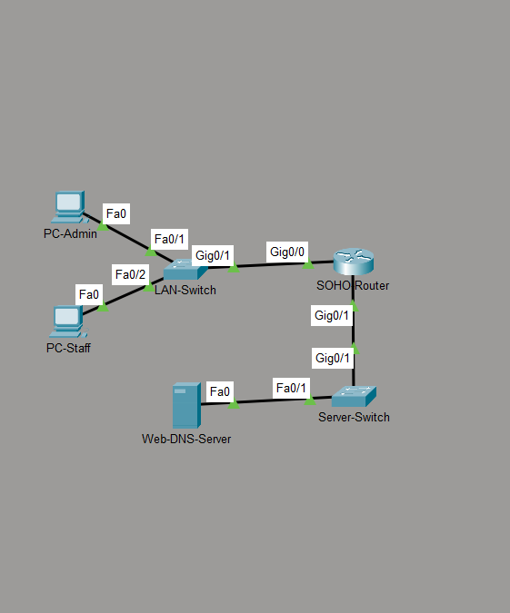

# 01 — SOHO Network with Routing, DHCP & DNS Services

## Project Overview
This lab simulates a Small Office / Home Office (SOHO) network built in packet tracer. It connects an employee workstation to a dedicated server via a Cisco 2911 router, automatically getting an IP configuration from a DHCP server and enabling internal web browsing by domain name through local dns and http services.

---

## Devices Used
* Router: 1× Cisco 2911 (`SOHO-Router`)
* Switches: 2× Cisco 2960-24TT (`LAN-Switch`, `Server-Switch`)
* Endpoints: 2× PCs (`PC-Admin`, `PC-Staff`)
* Server: 1× Generic Server (`Web-DNS-Server`)

---

## Key Concepts Demonstrated
* Multi-Subnet Routing: Configured Layer 3 gateway interfaces (`GigabitEthernet0/0` and `GigabitEthernet0/1`) to route traffic between `192.168.10.0/24` and `192.168.20.0/24`.
* Cisco IOS CLI Administration: Configured interfaces, DHCP pools, and saved startup configurations to NVRAM via the command line.
* DHCP Automation & Exclusions: Reserved `.1`–`.10` for static infrastructure while dynamically leasing IP addresses, subnet masks, default gateways, and DNS settings to office workstations.
* DNS Name Resolution & Web Hosting: Configured an HTTP web server and DNS `A Record` so users can reach `www.office.local`.

---

## IP Addressing & Network Table

| Device / Segment | Interface | IPv4 Address | Subnet Mask | Default Gateway | DNS Server | Assignment Method |
| :--- | :--- | :--- | :--- | :--- | :--- | :--- |
| **SOHO-Router (LAN)** | `Gig0/0` | `192.168.10.1` | `255.255.255.0` | N/A | N/A | Static (CLI) |
| **SOHO-Router (Servers)** | `Gig0/1` | `192.168.20.1` | `255.255.255.0` | N/A | N/A | Static (CLI) |
| **PC-Admin** | `FastEth0` | `192.168.10.12` | `255.255.255.0` | `192.168.10.1` | `192.168.20.100` | DHCP (`OFFICE_LAN`) |
| **PC-Staff** | `FastEth0` | `192.168.10.13` | `255.255.255.0` | `192.168.10.1` | `192.168.20.100` | DHCP (`OFFICE_LAN`) |
| **Web-DNS-Server** | `FastEth0` | `192.168.20.100` | `255.255.255.0` | `192.168.20.1` | `192.168.20.100` | Static |

---

## Verification & Testing
1. DHCP Lease Verification: Confirmed active IP leases on `SOHO-Router` using `show ip dhcp binding` and verified endpoints pulled `.12` and `.13`. `.11` was taken when I toggled PC-Admin from Static to DHCP in IP Configuration settings.
2. Cross-Subnet Connectivity: Executed `ping 192.168.20.100` from `PC-Admin` with 100% packet success across `SOHO-Router`.
3. DNS & HTTP Resolution: Opened the Packet Tracer Web Browser on `PC-Staff` and loaded `wwwoffice.local` by hostname.

---

## Files in This Folder
* [`soho-network-lab.pkt`](./soho-network-lab.pkt) — Cisco Packet Tracer simulation file.
* [`configs/soho-router-config.txt`](./configs/soho-router-config.txt) — Exported `show running-config` output from `SOHO-Router`.
* [`topology.png`](./topology.png) — Annotated diagram of the network layout.
